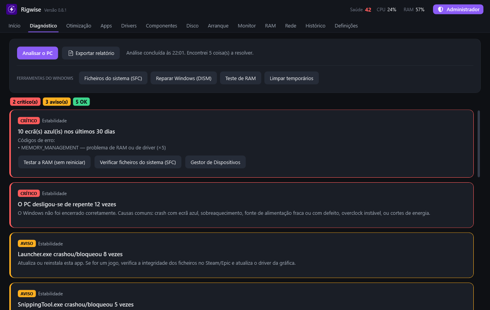

# Rigwise

**Descobre porque é que o PC está lento, crasha ou dá lag — e resolve.** 
*Finds out why your PC is slow, crashes or lags — and fixes it.*

### [⬇ Descarregar / Download](https://github.com/DinisIvanetsD/pc-optimizer-releases/releases/latest/download/PCOptimizer-win-x64.zip) · [Site](https://dinisivanetsd.github.io/pc-optimizer-releases/)

## O que faz

| | |
|---|---|
| 🔍 **Diagnóstico** | Ecrãs azuis, RAM instável, discos, drivers e rede, explicados em linguagem simples, com um botão para resolver. |
| ⚡ **Otimização** | Perfis para jogos, rede, vídeo, música, trabalho e privacidade. Cada ajuste pode ser desfeito. |
| 🎮 **Modo jogo** | Deteta o jogo, mede o ping ao servidor ao vivo e mostra se o lag vem da tua casa, do operador ou do servidor. |
| 📦 **Apps** | Instala e atualiza mais de 50 apps populares de uma vez, pelo winget da Microsoft. |
| 🔧 **Drivers** | Drivers em falta ou antigos, das fontes oficiais (NVIDIA, AMD, Microsoft). |
| 🧠 **Teste de RAM** | Procura erros na memória sem reiniciar o PC. |
| ↶ **Histórico** | Tudo o que a app mudou, com Desfazer. |

Em **português** e **inglês**. Sem anúncios, sem conta, sem enviar os teus dados.

## Instalar

1. [Descarrega o ZIP](https://github.com/DinisIvanetsD/pc-optimizer-releases/releases/latest/download/PCOptimizer-win-x64.zip) e extrai-o (botão direito › Extrair tudo).
2. Abre o `PCOptimizer.exe`. Se aparecer o aviso azul do Windows, clica em **Mais informações › Executar mesmo assim** (a app ainda não tem assinatura digital paga).
3. Em **Definições › Instalar no PC** fica no Menu Iniciar e atualiza-se sozinha.

---

<b>English</b>

- **Diagnostics**: blue screens, unstable RAM, disks, drivers and network, explained in plain words with a fix button.
- **Optimization**: profiles for gaming, network, video, music, work and privacy. Every tweak can be undone.
- **Game mode**: detects your game, measures live ping to the server and shows whether lag comes from your home, your ISP or the server.
- **Apps**: install and update 50+ popular apps in one go, through Microsoft's winget.
- **Drivers**: missing or outdated drivers from official sources (NVIDIA, AMD, Microsoft).
- **RAM test** without restarting, and a **History** of every change with Undo.

**Install:** download the ZIP, extract it and open `PCOptimizer.exe`. If Windows shows the blue SmartScreen warning, click **More info › Run anyway** (the app isn't code-signed yet). Then use **Settings › Install on PC** to add it to the Start menu with automatic updates.

Este repositório só tem as versões publicadas; o código-fonte é privado. · This repository only hosts the releases; the source code is private.
