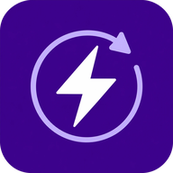
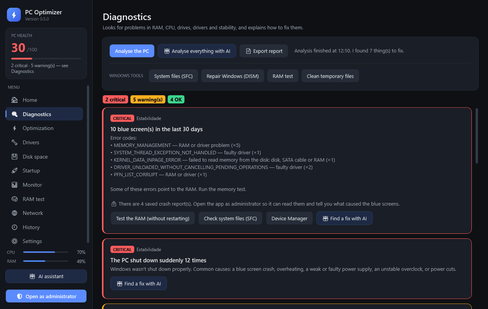

# Rigwise

**Finds out why your PC is slow, crashes or lags — and fixes it.**

### [⬇ Download](https://github.com/DinisIvanetsD/pc-optimizer-releases/releases/latest/download/PCOptimizer-win-x64.zip) · [Website](https://dinisivanetsd.github.io/pc-optimizer-releases/)

## What it does

| | |
|---|---|
| 🔍 **Diagnostics** | Blue screens, unstable RAM, disks, drivers and network, explained in plain words, with a button to fix each one. |
| ⚡ **Optimization** | Profiles for gaming, network, video, music, work and privacy. Every tweak can be undone. |
| 🎮 **Game mode** | Detects your game, measures live ping to the server and shows whether lag comes from your home, your ISP or the server. |
| 📦 **Apps** | Install and update 50+ popular apps in one go, through Microsoft's winget. |
| 🔧 **Drivers** | Missing or outdated drivers from official sources (NVIDIA, AMD, Microsoft). |
| 🧠 **RAM test** | Checks your memory for errors without restarting the PC. |
| ↶ **History** | Everything the app changed, with Undo. |

In **English** and **Portuguese**. No ads, no account, none of your data sent anywhere.

## Install

1. [Download the ZIP](https://github.com/DinisIvanetsD/pc-optimizer-releases/releases/latest/download/PCOptimizer-win-x64.zip) and extract it (right-click › Extract All).
2. Open `PCOptimizer.exe`. If Windows shows the blue SmartScreen warning, click **More info › Run anyway** (the app isn't code-signed yet).
3. Go to **Settings › Install on the PC** to add it to the Start menu. It then updates itself.

---

<b>Português</b>

**Descobre porque é que o PC está lento, crasha ou dá lag — e resolve.**

- **Diagnóstico**: ecrãs azuis, RAM instável, discos, drivers e rede, explicados em linguagem simples, com um botão para resolver.
- **Otimização**: perfis para jogos, rede, vídeo, música, trabalho e privacidade. Cada ajuste pode ser desfeito.
- **Modo jogo**: deteta o jogo, mede o ping ao servidor ao vivo e mostra se o lag vem da tua casa, do operador ou do servidor.
- **Apps**: instala e atualiza mais de 50 apps populares de uma vez, pelo winget da Microsoft.
- **Drivers**: em falta ou antigos, das fontes oficiais (NVIDIA, AMD, Microsoft).
- **Teste de RAM** sem reiniciar e **Histórico** de tudo o que mudou, com Desfazer.

**Instalar:** descarrega o ZIP, extrai-o e abre o `PCOptimizer.exe`. Se aparecer o aviso azul do Windows, clica em **Mais informações › Executar mesmo assim** (a app ainda não tem assinatura digital paga). Depois, em **Definições › Instalar no PC**, fica no Menu Iniciar e atualiza-se sozinha.

This repository only hosts the releases; the source code is private.
